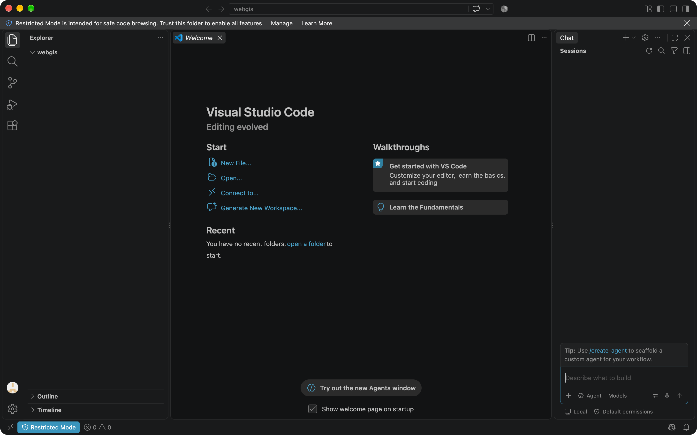
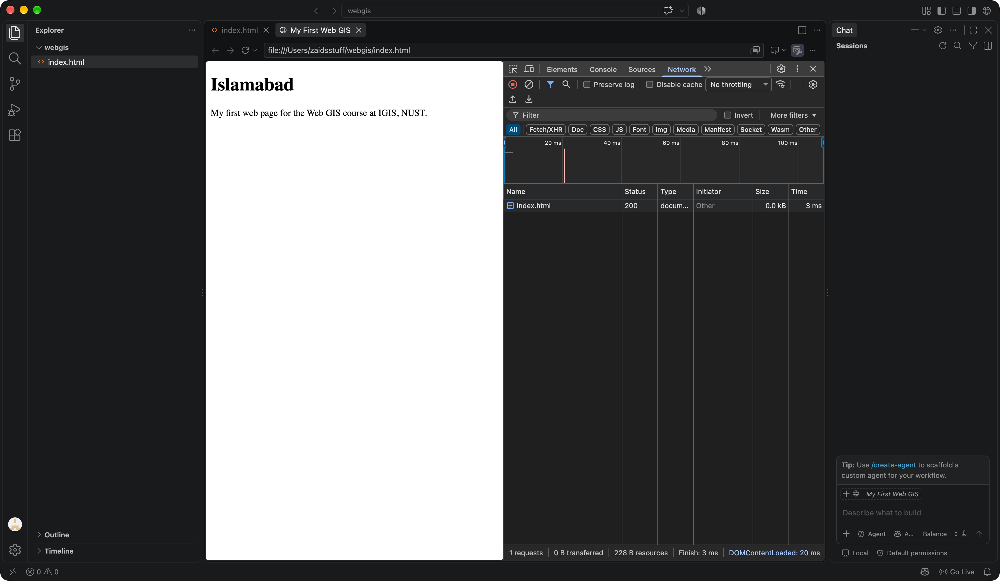
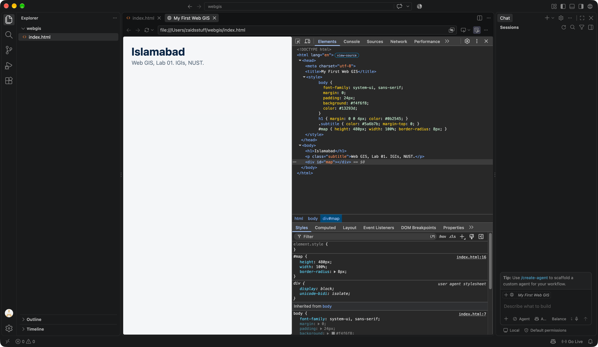
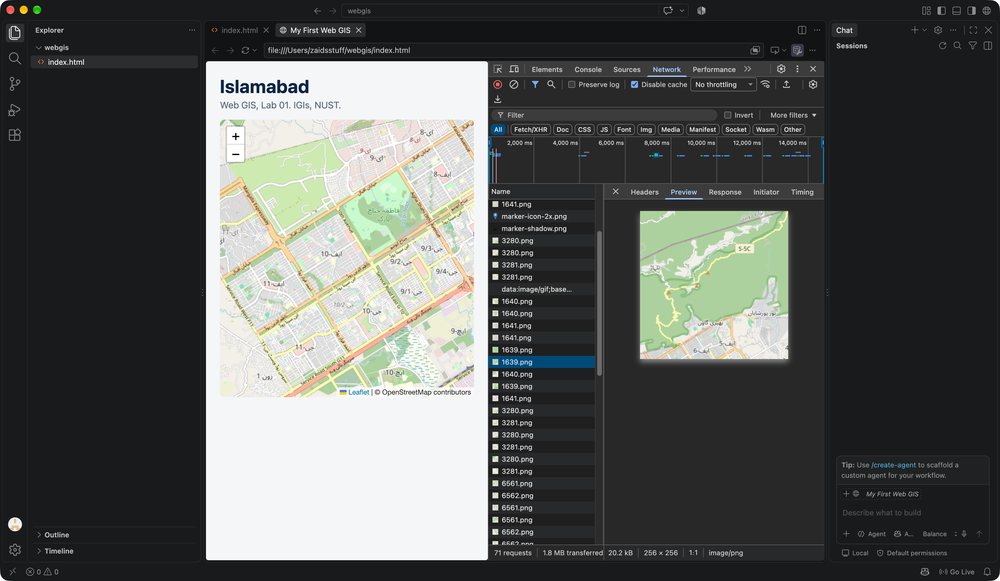
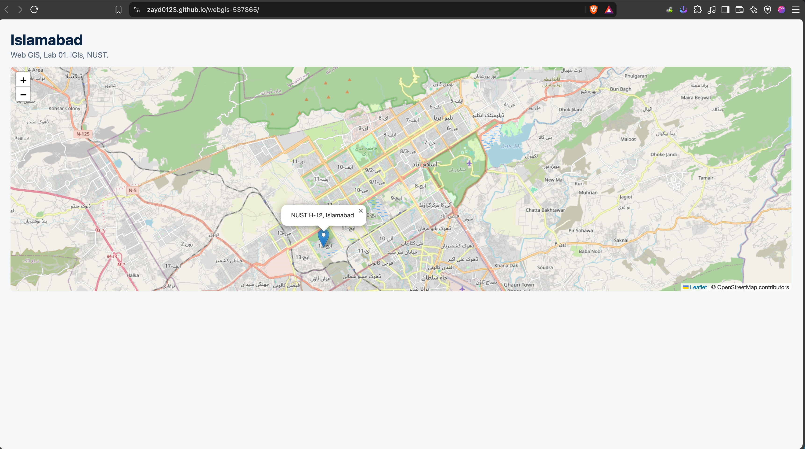

# Lab 1 — My First Web GIS

**GIS874 Web GIS**
Institute of Geographical Information Systems
School of Civil and Environmental Engineering
National University of Sciences and Technology, Islamabad

| | |
|---|---|
| Name | Zaid Younas |
| Reg # | 537865 |
| Submitted to | Dr. Shahid Nawaz Khan |
| Repository | https://github.com/zayd0123/webgis-537865 |
| Live page | https://zayd0123.github.io/webgis-537865/ |

---

## 0. Setting up

Created `C:\webgis`, opened it in VS Code, and installed the **Live Server**
extension. Live Server matters because it serves the folder over `http://` rather
than letting the browser open the file directly — the difference is what question
4 is about.

### Checkpoint 1 — the project folder

*VS Code with the empty `webgis` folder open in the Explorer panel.*



---

## 1. The page

A single `index.html` containing the structure, the styling and the script. At
this size there is no reason to split them, and keeping one file makes it clear
how the three languages work together.

```html
<h1>Islamabad</h1>
<p class="subtitle">Web GIS, Lab 01. IGIs, NUST.</p>
<div id="map"></div>
```

That is the entire visible page: a heading, a subtitle, and an empty box waiting
for the map.

On first load the browser makes exactly **one** request — for `index.html` itself.

### Checkpoint 2 — the page rendering

*The page in the browser with Developer Tools open. The Network tab shows a
single request: `index.html`.*



---

## 2. Styling with CSS

The CSS lives in a `<style>` block in the head. Four rules do all the work:

```css
body { font-family: system-ui, sans-serif; margin: 0; padding: 24px;
       background: #f4f6f8; color: #13293d; }
h1         { margin: 0 0 4px; color: #0b2545; }
.subtitle  { color: #5a6b7b; margin-top: 0; }
#map       { height: 480px; width: 100%; border-radius: 8px; }
```

The `#map` rule is the one that matters most. A `<div>` is empty, so it has no
content to give it height; without `height: 480px` it collapses to zero pixels and
Leaflet draws a map zero pixels tall with no error in the console.

### Checkpoint 3 — styling, with the rules visible

*The styled heading and subtitle, with `div#map` selected in the Elements panel and
its CSS rules shown in the Styles pane — `height: 480px` among them.*



---

## 3. Adding the map

Leaflet is loaded from the unpkg CDN, then three calls build the map:

```js
const map = L.map('map').setView([33.6844, 73.0479], 12);

L.tileLayer('https://tile.openstreetmap.org/{z}/{x}/{y}.png', {
  maxZoom: 19,
  attribution: '&copy; OpenStreetMap contributors'
}).addTo(map);

L.marker([33.6423, 72.9906])
  .addTo(map)
  .bindPopup('NUST H-12, Islamabad')
  .openPopup();
```

`setView` takes `[latitude, longitude]` — Leaflet's order, which is the reverse of
GeoJSON's. The marker sits at NUST H-12, inside Kashmir Highway.

Adding the map changes the network profile completely. Before this step the page
made **one** request; now the tile layer fetches a separate 256 × 256 PNG for every
visible square of map, and panning or zooming asks for more.

### Checkpoint 4 — the map, with its tile requests

*The working map with the Network tab open. One PNG tile is selected and its
Preview tab shows a single 256 × 256 image.*



---

## 4. Publishing

Committed the folder to `webgis-537865` and enabled GitHub Pages, deploying from
the `main` branch at the repository root.

| | |
|---|---|
| Repository | <https://github.com/zayd0123/webgis-537865> |
| Live page | <https://zayd0123.github.io/webgis-537865/> |

### Checkpoint 5 — the live URL

*The published page on `github.io`, with the marker popup open.*



---

## 5. Answers to the five questions

### 1. In Part 2 your page made one network request. After Part 4 it made dozens. Explain in two or three sentences what changed and why.

In Part 2 the page was only HTML and CSS written inside the file itself, so the
browser needed just one request — for `index.html`. After Part 4, Leaflet is loaded
from an external CDN and the map tiles are fetched from OpenStreetMap one square at
a time, so each visible tile becomes its own HTTP request. Panning or zooming
triggers new tile requests, which is why the count grows into the dozens.

The Network tab in Checkpoint 4 shows this directly: the first screenshot has one
request, the map has **71 requests** and 1.8 MB transferred.

### 2. What is the difference between what HTML does and what CSS does? Give one example of each from your own file.

HTML defines the structure and content of the page — what exists. CSS defines the
appearance — how it looks.

In my file, `<h1>Islamabad</h1>` is HTML: it creates a level-one heading with that
text in it. And `h1 { color: #0b2545; }` is CSS: it colours that heading dark navy.
The heading would still exist and still read "Islamabad" without the CSS; it would
simply be black.

### 3. Why does the `#map` rule need a height, when the `h1` rule does not?

An `<h1>` contains text, so its height is determined by the size of that text —
the content gives it size. The `<div id="map">` is empty: it has no content to
derive height from, so without an explicit height it collapses to zero pixels and
the map has nowhere to draw. Setting `height: 480px` gives the container a real box
for Leaflet to fill.

### 4. You opened your page through Live Server at `127.0.0.1` instead of double-clicking the file. Give one reason this matters.

When a file is opened directly, the browser uses the `file://` protocol and treats
the page as having no origin, so it blocks requests for external data files. Live
Server serves the page over `http://`, exactly like a real web server, so tiles,
GeoJSON files and API calls behave locally the same way they will once published.
This matters from Lab 2 onwards, where the page fetches a GeoJSON file at runtime —
under `file://` that request fails silently.

### 5. A classmate's marker appears in the sea near Africa instead of in Islamabad. What is almost certainly wrong, and how would you fix it?

Latitude and longitude are swapped. The coordinates `[33.64, 72.99]` were probably
written as `[72.99, 33.64]`, which places the point in the Arabian Sea off the coast
of Africa. Leaflet expects `[latitude, longitude]`, so swapping the two numbers back
fixes it. A quick check: latitude in Pakistan is in the twenties or thirties,
longitude in the sixties or seventies — the ranges do not overlap, so a swap is
easy to spot.

---

## 6. Files

| File | What it holds |
|---|---|
| `index.html` | the whole page: structure, CSS and the map script |
| `report.md` | this report |
| `Report/` | the five checkpoint screenshots |
| `Report/lab01.md` | the same report in the plain format the handout asked for |

Run it locally by serving the folder over HTTP:

```
python3 -m http.server 5500
```

then open <http://127.0.0.1:5500>.

## 7. Data source

| Source | Detail |
|---|---|
| Basemap | OpenStreetMap tiles, via `tile.openstreetmap.org` |
| Mapping library | Leaflet 1.9.4, loaded from unpkg |
