# Lab 4 — GeoDjango with PostGIS

Name: Zaid Younas
Reg #: 537865
GIS874 Web GIS
Submitted to Dr. Shahid Nawaz Khan

Repository: https://github.com/zayd0123/webgis-537865
Project folder: `lab4/`

Done in Windows 11 running inside Parallels, so a few steps differ from the
handout. The differences are listed under Problems.

## Versions

| Software | Version |
|---|---|
| Windows | 11, ARM64 |
| Python | 3.14.10 (x64) |
| Django | 6.1.2 |
| psycopg | 3.3.6 |
| PostgreSQL | 18.6 |
| PostGIS | 3.6.2 |
| GDAL | 3.13.3 |
| GEOS | 3.15.0 |
| PROJ | 8.2.1 |

The output of `postgis_full_version()`:

```
POSTGIS="3.6.2 3.6.2" [EXTENSION] PGSQL="180" GEOS="3.14.1dev-CAPI-1.20.4"
PROJ="8.2.1" NETWORK_ENABLED=OFF
```

There are two GEOS versions in this report because there are two copies.
PostGIS uses its own (3.14.1dev). GeoDjango loads the one from OSGeo4W (3.15.0).

## Checkpoints

### 1. Django running

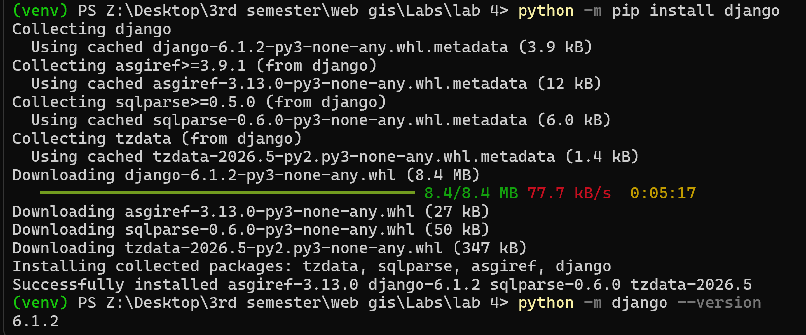

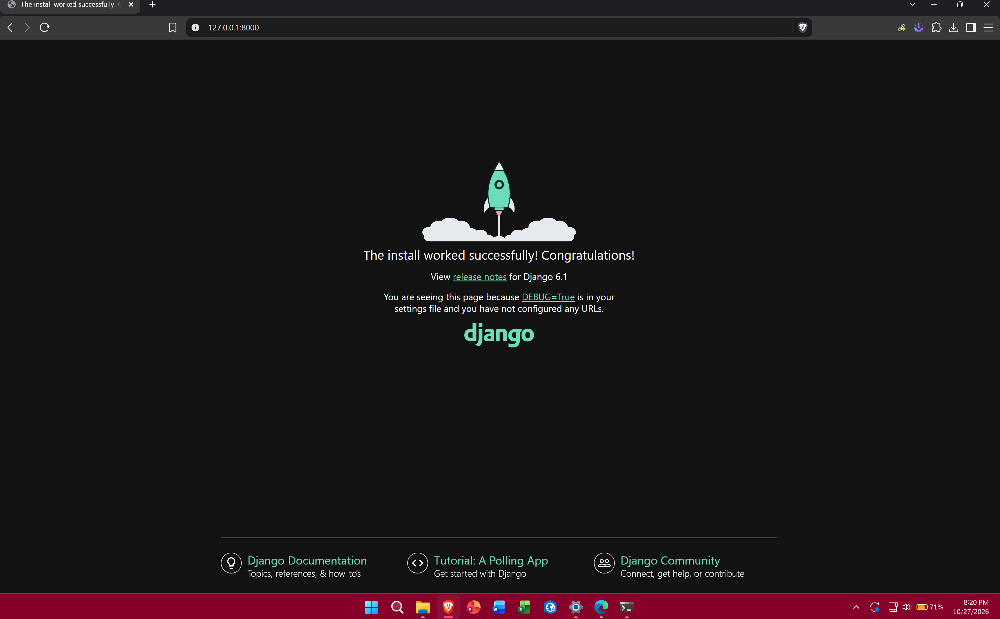

### 2. PostGIS in pgAdmin


### 3. Django connected to PostGIS

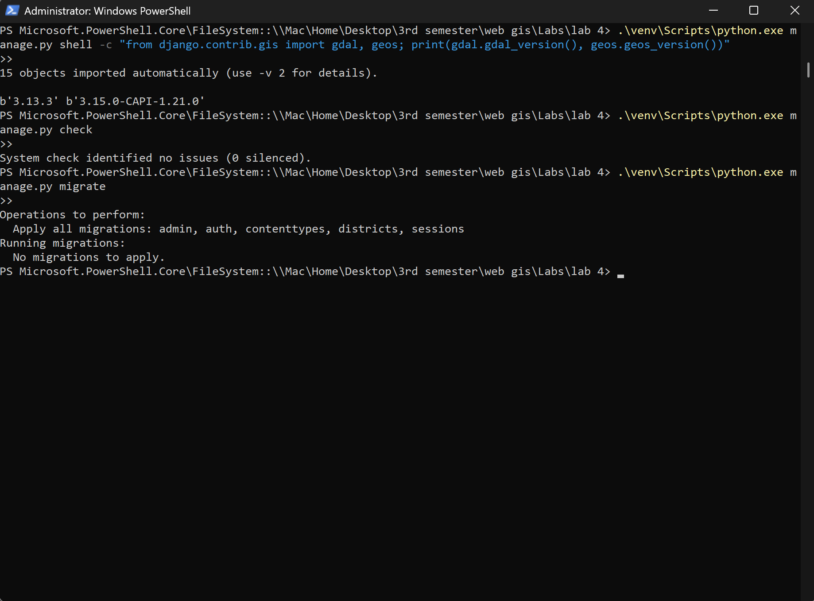

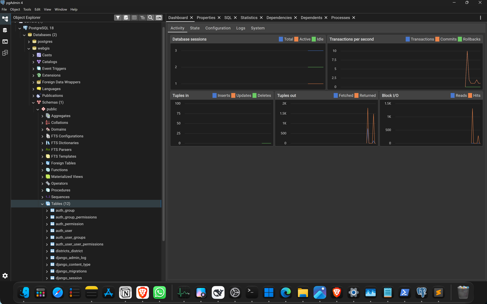

### 4. Model to table

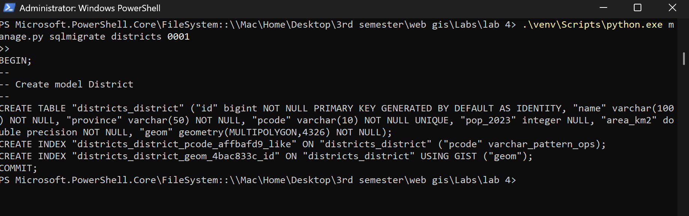

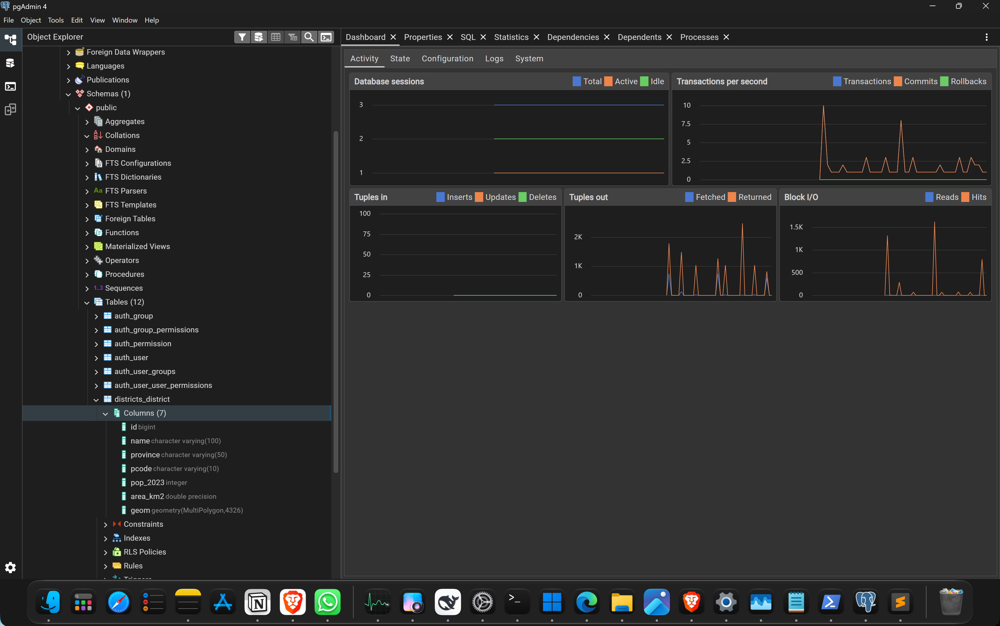

### 5. Loading the districts


### 6. Admin panel


The population was set back to 13004135 afterwards.

### 7. Leaflet fed by Django


Brave on this machine has the developer tools blocked by a machine policy, so
the Network tab would not open and the request could not be inspected there.
The size of the response was measured in the Console instead:

```javascript
fetch('/api/districts/').then(r => r.text()).then(t => console.log('bytes:', t.length))
```

That printed `bytes: 1006250`.


### 8. Spatial question


## Problems

Part of this lab is installation. On an ARM64 virtual machine a lot of it failed
the first time, so here is every error in the order it happened, copied as it
appeared.

**1. Activating the virtual environment**

```
venv\Scripts\Activate.ps1 : The module 'venv' could not be loaded.
+ FullyQualifiedErrorId : CouldNotAutoLoadModule
```

PowerShell does not run scripts from the current folder without a `.\` prefix.
Used `.\venv\Scripts\Activate.ps1` instead.

**2. The wrong Python was first on PATH**

```
pip 26.2.2 from C:\Users\zaidsstuff\AppData\Local\Python\pythoncore-3.15-arm64\Lib\site-packages\pip (python 3.15)
```

Django 6.1 does not support 3.15. The machine had 3.15, 3.14 and a third 3.14
build. Created the virtual environment from 3.14 explicitly so that everything
inside it is 3.14 whatever the machine default is.

**3. pip refused to install outside the environment**

```
error: externally-managed-environment
This Python installation is managed by uv and should not be modified.
```

This happened after dropping out of the virtual environment without noticing.
`python` had gone back to the uv-managed 3.14. Fixed by always calling
`.\venv\Scripts\python.exe` directly, which cannot pick up the wrong
interpreter.

**4. No psycopg binary for this machine**

```
ERROR: ResolutionImpossible
some packages in these conflicts have no matching distributions available
for your environment: psycopg-binary
```

There is no ARM64 Windows build of `psycopg-binary`. Installed plain `psycopg`
instead, which is pure Python and uses the `libpq.dll` that PostgreSQL installs.

**5. libpq not found**

```
ImportError: no pq wrapper available.
- couldn't import psycopg 'python' implementation: libpq library not found
```

The DLL was on disk but its folder was not on PATH. Added
`C:\Program Files\PostgreSQL\18\bin` to PATH.

**6. Wrong architecture**

```
- couldn't import psycopg 'python' implementation: [WinError 193] %1 is not a
  valid Win32 application
```

This was the real cause of the last two. The Python was an ARM64 build and
`libpq.dll` is x64, so it could not be loaded at all. Checked with:

```
python -c "import sysconfig; print(sysconfig.get_platform())"
```

which returned `win-arm64`. Note that `platform.machine()` is no help here. It
reads `PROCESSOR_ARCHITECTURE`, which Windows sets to the machine's architecture,
so it reports ARM64 even for an x64 process.

Fixed by installing the x64 build of Python 3.14 from python.org and making the
virtual environment from that. The same problem would have hit GDAL later, since
OSGeo4W is x64 too.

**7. The database server was not running**

```
createdb: error: connection to server at "localhost" (::1), port 5432 failed:
Connection refused (0x0000274D/10061)
```

The PostgreSQL service had not started after installation. Started it with
`Start-Service postgresql-x64-18` from an administrator PowerShell.

**8. Password rejected**

```
FATAL: password authentication failed for user "postgres"
```

The password chosen during installation did not work. Reset it by setting the two
localhost lines in `pg_hba.conf` from `scram-sha-256` to `trust`, restarting the
service, running `ALTER USER postgres WITH PASSWORD`, then setting the file back
and restarting again.

**9. Stack Builder stopped responding**

It sat on "Review your selections" showing "Not Responding" for about ten
minutes, twice. The first time a download did eventually start and finish. The
second time it did not. Downloaded the bundle directly instead:

```
https://download.osgeo.org/postgis/windows/pg18/postgis-bundle-pg18x64-setup-3.6.2-1.exe
```

**10. OSGeo4W installer closed immediately**

Running `osgeo4w-setup.exe` from the Mac share (`Z:`) closed it after a second.
The copy at that path could not be started at all:

```
.\osgeo4w-setup.exe : The term '.\osgeo4w-setup.exe' is not recognized as the
name of a cmdlet, function, script file, or operable program.
```

and once the drive mapping dropped:

```
Copy-Item : Cannot find drive. A drive with the name 'Z' does not exist.
```

Copying the file to the Windows disk first, using the `\\Mac\Home\...` path
rather than the `Z:` letter, and running it from there worked.

**11. OpenStreetMap tiles blocked**

```
403 Access blocked. App is not following the tile usage policy of
OpenStreetMap's volunteer-run servers: osm.wiki/Blocked
```

The districts drew fine, so only the basemap was affected. The same tile URL
worked from the host machine, so the block was specific to this VM, probably
because it goes out through a VPN. CARTO was tried next and now needs an API key,
which showed up as `API KEY REQUIRED` watermarks across the map. The page was
switched to OpenStreetMap France, which serves the same data from different
servers:

```javascript
L.tileLayer('https://{s}.tile.openstreetmap.fr/osmfr/{z}/{x}/{y}.png', { ... })
```

The handout's own colour dictionary has trailing spaces in three province names
(`'Khyber Pakhtunkhwa '`, `'Azad Kashmir '`, `'Gilgit Baltistan '`). Those do not
match the values in the database, so three provinces would have been grey.
Removed the spaces.

**12. Brave blocked the developer tools**

```
DevTools not allowed on this page
Your organization has blocked the use of DevTools on this page
```

A machine policy, `DeveloperToolsDisabled = 1` under
`HKLM\SOFTWARE\Policies\BraveSoftware\Brave`. Removed the value and restarted
the browser.

**13. The Network panel still would not render**

After the policy was removed the tab opened but stayed blank, with no toolbar and
no request list. That is why the response size under Checkpoint 7 was measured in
the Console instead of the Network tab.

## Area comparison

One query, three ways of measuring the same polygons:

| District | Latitude | `area_km2` | `ST_Area(geography)` | `ST_Transform(3857)` | Mercator too big by |
|---|---|---|---|---|---|
| Gwadar | 25.4 | 11,574 | 11,575 | 14,246 | 23.1% |
| Lahore | 31.5 | 1,730 | 1,730 | 2,386 | 37.9% |
| Gilgit | 36.0 | 4,016 | 4,015 | 6,133 | 52.7% |

The stored figure and the geodesic area agree to the nearest square kilometre.
They are the same measurement done two ways, which suggests the loaded data is
right.

Web Mercator is too large, and it gets worse further north. Gilgit is at 36
degrees, where 1/cos²(36) is 1.53, so 53% is what the formula predicts.

## Optional extras

The four tasks at the end of the handout.

**1. Province drop-down, filtering in the database**

The menu is filled from the data. Choosing a province re-requests
`/api/districts/?province=...`, so Sindh comes back as 29 rows instead of 160 and
the other 131 never leave the server.

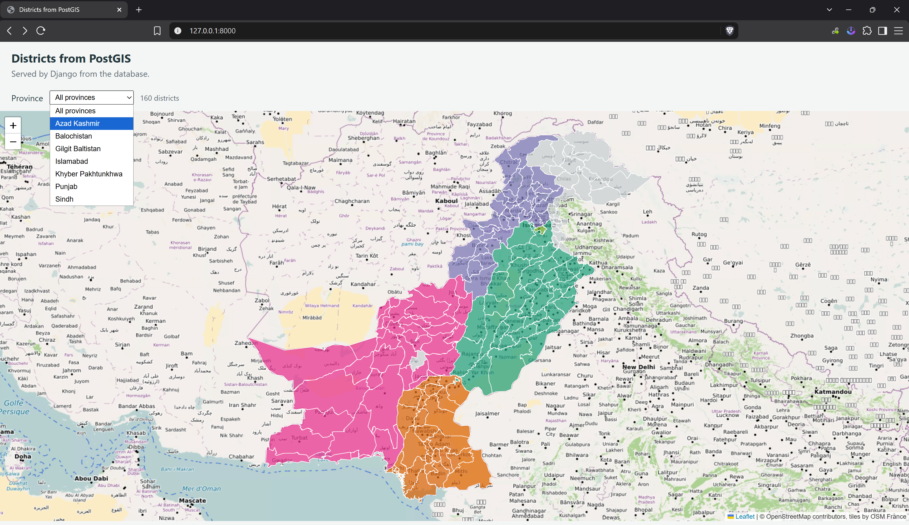

**2. Facility model**

A second model with a `PointField`, registered in the admin. Three facilities
added by clicking on the admin map: a protected area, NUST and QAU.

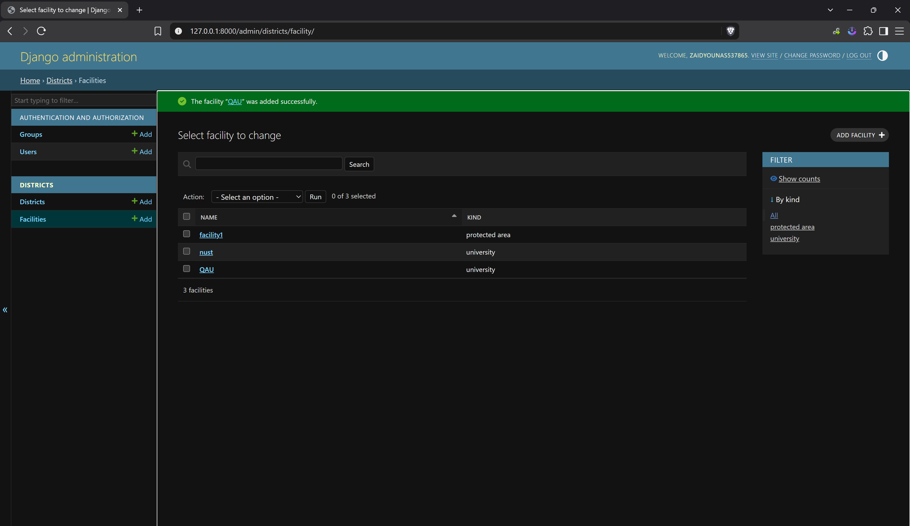

**3. Restricted user**

An `editor` account with view and change permission on District, but not delete.
Signed in, the admin shows only Districts, and the change form has Save but no
Delete button. (The "Delete all Features" link under the geometry widget clears
the shape from the form, not the row.)

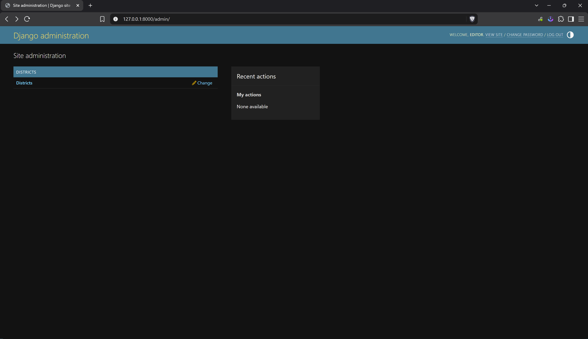

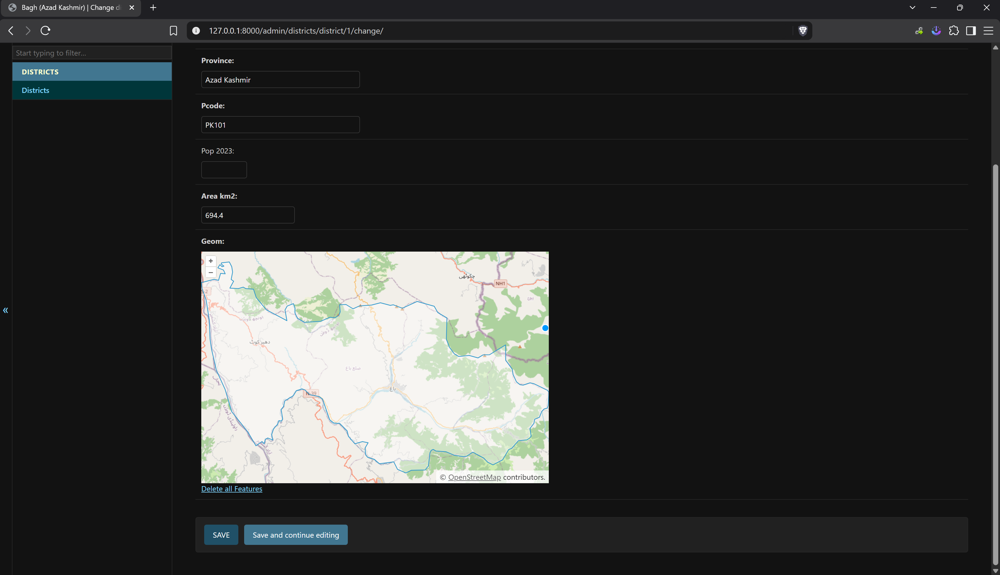

**4. Grey where there is no census figure**

The style now looks at `pop_2023` before choosing a colour. A null gets grey
`#c9cfd1` instead of a province colour, so Azad Kashmir, Gilgit Baltistan and
Lehri read as "not recorded" rather than as low population. Hovering any of them
confirms it with the tooltip and popup.

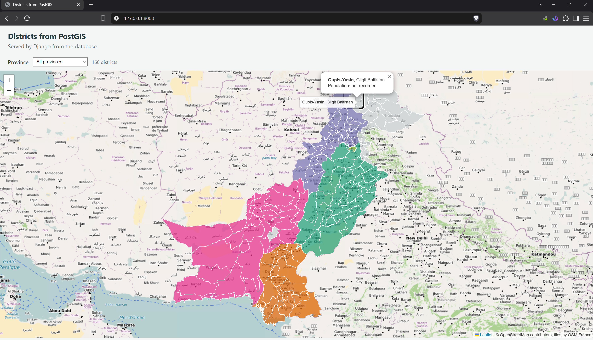

## Questions

### 1. Every visitor used to download the whole GeoJSON file. What can a page backed by Django and PostGIS do instead? Two examples.

It can choose what to send, and it can do work before sending anything.

The first example is the province filter. `/api/districts/?province=Sindh`
returns 29 features instead of 160, because the filtering happens in the database
query. The browser never receives the other 131 districts.

The second is `/api/where/`, which takes a latitude and longitude and returns one
district's name and population. No geometry crosses the network at all. PostGIS
does the point-in-polygon test on the server and sends back three values.

Another difference is that the data can be corrected without editing a file and
pushing a commit, since the admin panel writes straight to the table.

### 2. Why read the database password from an environment variable instead of putting it in settings.py?

Because `settings.py` goes into the repository, and the repository is public. A
password written there would be readable by anyone who opens the GitHub page, and
it would stay in the commit history even after being removed.

With an environment variable the file only says where to look. Each machine
supplies its own value, so the same file can be shared without exposing anything,
and a server can use a different password without any code change.

### 3. What does the index created USING GIST do, and which query benefits?

It is a spatial index on the `geom` column. GeoDjango adds one to every geometry
field automatically.

Without it, asking which district contains a point means testing the point
against the full outline of all 160 districts. With it, PostGIS keeps a tree of
bounding boxes, so it can throw out any district whose box does not contain the
point and only check the outlines of the few that might.

The query that benefits is the one in `district_at`, `geom__contains=point`,
which becomes `ST_Contains` in SQL. That is the query behind clicking the map.
The province filter does not use it at all, because it filters a text column.

### 4. What would happen without the MultiPolygon wrapping?

The column is a `MultiPolygonField`, so it is created as
`geometry(MULTIPOLYGON,4326)`. PostGIS checks the type on insert. A plain
`POLYGON` value would be rejected with an error about the geometry type not
matching the column, and that district would not be loaded.

Wrapping a single polygon in a MultiPolygon of one part changes nothing on the
map. It is the same shape with one more level of nesting, which is what the
column requires.

In this case the step never ran. Lab 2's export had already made all 160 features
MultiPolygon, so the loader reported `MultiPolygon` for the layer and every
feature arrived wrapped. The handout expects `Unknown` because its copy of the
file has 152 polygons and 8 multipolygons in it.

### 5. Who should have an admin login, and who should not?

The people who look after the boundary data, and almost nobody else.

Anyone who can log in can edit or delete every row, including the geometry, and
there is no undo beyond the history page. So accounts should go to the small
group responsible for the layer, not the whole department and not the public.

Where other people need access, Django's permissions allow narrower accounts. One
that can change a population figure but not delete a district, or one that can
only view. That covers most real cases. The public map should read from the API
instead.

### 6. Leaflet takes [lat, lng] and Point takes (lng, lat). Where is each used here, and how does the URL avoid confusion?

Leaflet uses latitude first in three places: `setView([30.3753, 69.3451], 5)`,
the `maxBounds` box `[[21.5, 58.5], [39.0, 80.5]]`, and the click handler, where
`e.latlng.lat` and `e.latlng.lng` are read as separate values.

GEOS uses longitude first, so the view builds the point as
`Point(lng, lat, srid=4326)`. That is the same order GeoJSON uses.

The URL avoids the problem by naming both values. The handler sends
`?lat=33.6423&lng=72.9906` and the view reads `request.GET["lat"]` and
`request.GET["lng"]` by name rather than by position. Nothing depends on the
order they appear in, and a swap would have to be written deliberately.

In the database the order is GeoJSON's as well, since `ST_MakePoint(72.9906, 33.6423)`
in the pgAdmin query is longitude first. That is the place where a mistake is
easiest to miss, because a reversed point often still lands somewhere inside
Pakistan.
